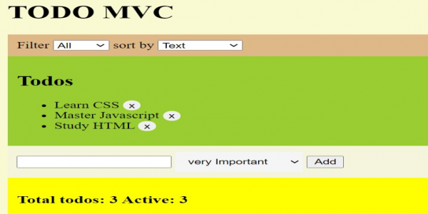

# Todo MVC

A todo list app built with vanilla JavaScript using the MVC pattern, with data saved in the browser.

**[▶ Try the live demo](https://avraham186.github.io/todoAppVanila/)**

## Features

- Add, complete and delete todos
- Filter by all / active / done
- Importance level for each todo (3 levels)
- Sort by text, creation time or importance
- Live counters for total and active todos
- Persists to `localStorage`, so the list survives a page refresh

## Tech

- Vanilla JavaScript, MVC structure (`todo.service.js`, `storage.service.js`, `todo-controller.js`)
- HTML5, CSS3

## Run locally

No build step: clone the repo and open `index.html` in a browser.
